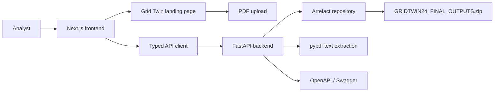

# Grid Twin

Grid Twin is a day-ahead electricity-demand intelligence workspace. It presents an auditable 24-hour demand forecast, model-quality metrics, data-quality caveats, exported training artefacts, and readable PDF report text.

The product is designed for energy analysts and grid-operations users. It does not claim household-level forecasts, real-world grid intervention, or savings that are not supported by the supplied artefacts.

## What It Includes

- React and Next.js landing page with the official React Bits `GradientASCII` visual.
- Grid Twin day-ahead forecast workspace.
- Real forecast values loaded from `GRIDTWIN24_FINAL_OUTPUTS.zip`.
- Forecast peak, daily energy, holdout WAPE, interval coverage, and model leaderboard.
- PDF upload with text extraction through FastAPI and a local browser fallback.
- FastAPI backend for run summaries, forecast rows, health checks, and PDF extraction.
- OpenAPI and Swagger documentation for the backend.
- Vercel frontend and Render backend deployment configuration.

## Architecture



### Repository layout

```text
GridTwin/
├── backend/
│   ├── __init__.py
│   ├── main.py                 FastAPI application and API routes
│   └── requirements.txt        Python dependencies
├── public/
│   └── pdf.worker.min.mjs      Browser PDF.js worker
├── src/
│   ├── app/
│   │   ├── globals.css         Global visual system and responsive layout
│   │   ├── layout.tsx          Next.js root layout and metadata
│   │   └── page.tsx            Landing page, upload flow, and workspace
│   ├── components/
│   │   ├── GradientASCII.jsx   Official React Bits component
│   │   ├── GradientASCII.css   React Bits component styles
│   │   └── GradientASCII.d.ts   TypeScript declaration for the JS component
│   ├── data/
│   │   └── runData.ts          Bundled run fallback and typed forecast data
│   └── lib/
│       └── api.ts              Typed FastAPI client
├── GRIDTWIN24_FINAL_OUTPUTS.zip Model output archive used by the API
├── render.yaml                 Render deployment blueprint
├── .env.example                Environment variable template
├── components.json             shadcn registry configuration
└── package.json                Frontend scripts and dependencies
```

## Frontend flow

1. The landing page renders the React Bits `GradientASCII` background with the Grid Twin copy and two actions: `Upload PDF` and `Get started`.
2. PDF uploads are validated as PDF files under 25 MB.
3. The frontend first sends the document to `POST /api/documents/extract`.
4. If FastAPI is unavailable, PDF.js extracts text locally in the browser.
5. Clicking `Get started` opens the workspace.
6. The workspace requests the selected run summary and forecast from FastAPI.
7. If the API is unavailable, the bundled `src/data/runData.ts` values keep the interface usable.

## Backend API

The FastAPI application is in `backend/main.py`.

| Method | Endpoint | Purpose |
|---|---|---|
| `GET` | `/health` | Service health check |
| `GET` | `/api/runs` | List available training runs |
| `GET` | `/api/runs/{run_id}/summary` | Run metadata and validation summary |
| `GET` | `/api/runs/{run_id}/forecast` | Exact 24-hour forecast rows |
| `POST` | `/api/documents/extract` | Extract readable text from a PDF |
| `GET` | `/openapi.json` | Standard OpenAPI JSON |
| `GET` | `/swagger.json` | Swagger-compatible OpenAPI JSON alias |
| `GET` | `/docs` | Swagger UI |
| `GET` | `/redoc` | ReDoc API documentation |

The initial run ID is:

```text
gridtwin-final-2024-06-17
```

## Real training artefacts

The supplied archive contains:

- `run_metadata.json`
- `sample_forecast_one_origin.csv`
- `rolling_cv_leaderboard.csv`
- `final_holdout_leaderboard.csv`
- `final_holdout_predictions.csv`
- `final_holdout_predictions_with_intervals.csv`
- `final_holdout_horizon_errors.csv`
- `rolling_cv_horizon_errors.csv`
- `final_holdout_daily_peak_energy.csv`
- `data_anomaly_audit.csv`
- `feature_importance.csv`
- model files including `.joblib` and `.pt` artefacts
- `TRAINING_REPORT.md`

The attached run reports a forecast date of `2024-06-17`, an ensemble model, 671 untouched holdout observations, 7.04% holdout WAPE, 55.89% P10-P90 empirical interval coverage, 1,045 missing hourly slots, and five masked anomaly candidates.

The UI deliberately labels WAPE and interval coverage precisely. It does not call either metric generic accuracy.

## Local development

### Frontend

Requirements: Node.js 20+ and npm.

```bash
npm install
npm run dev
```

Open:

```text
http://localhost:3000
```

Production build:

```bash
npm run build
npm start
```

### Backend

Requirements: Python 3.10+ and pip.

```bash
python3 -m venv .venv
source .venv/bin/activate
pip install -r backend/requirements.txt
uvicorn backend.main:app --reload --host 0.0.0.0 --port 8000
```

Backend URLs:

```text
http://localhost:8000/health
http://localhost:8000/docs
http://localhost:8000/openapi.json
http://localhost:8000/swagger.json
```

The frontend defaults to `http://localhost:8000`. Override it with:

```env
NEXT_PUBLIC_API_URL=http://localhost:8000
```

## Deployment

### Vercel frontend

1. Push the repository to GitHub.
2. Import the repository into Vercel.
3. Keep the framework as Next.js.
4. Set this environment variable after deploying the backend:

```env
NEXT_PUBLIC_API_URL=https://YOUR-RENDER-SERVICE.onrender.com
```

5. Redeploy the frontend.

### Render backend

The repository includes `render.yaml`.

1. Create a new Render Blueprint.
2. Select the GitHub repository.
3. Render installs `backend/requirements.txt` and starts:

```bash
uvicorn backend.main:app --host 0.0.0.0 --port $PORT
```

4. Set the CORS variable to the Vercel domain:

```env
FRONTEND_ORIGINS=https://YOUR-VERCEL-DOMAIN.vercel.app
```

5. Confirm the Render health endpoint:

```text
https://YOUR-RENDER-SERVICE.onrender.com/health
```

Important: leave Render's **Root Directory** blank. The service starts from the repository root because `backend.main:app` imports the backend package and reads `GRIDTWIN24_FINAL_OUTPUTS.zip` from the repository root. Do not set Root Directory to `backend`.

Then use these deployed API documentation URLs:

```text
https://YOUR-RENDER-SERVICE.onrender.com/docs
https://YOUR-RENDER-SERVICE.onrender.com/openapi.json
https://YOUR-RENDER-SERVICE.onrender.com/swagger.json
```

### Render MCP in VS Code

The repository includes `.vscode/mcp.json` with the official Render MCP endpoint:

```json
{
    "servers": {
        "render": {
            "type": "http",
            "url": "https://mcp.render.com/mcp"
        }
    }
}
```

After opening the workspace, use VS Code's MCP server list to start `render` and complete Render authentication. The MCP connection is for inspecting and managing Render resources; the backend still needs to be deployed as the `gridtwin-api` service.

## Environment variables

Copy `.env.example` when configuring local development:

```env
NEXT_PUBLIC_API_URL=http://localhost:8000
FRONTEND_ORIGINS=https://frontend-pi-two-79.vercel.app
```

## Validation

The current project has been validated with:

```bash
npm run build
python3 -m py_compile backend/main.py
```

The frontend build passes. The backend syntax passes. Render installs the Python dependencies at deployment time from `backend/requirements.txt`.

## Design references

- `GRIDTWIN24_UI_SPEC.md` contains the product and data-contract requirements.
- `DESIGN-apple.md` contains the light analytical design direction.
- The landing hero uses the official React Bits `GradientASCII` component and its supplied blue palette.
